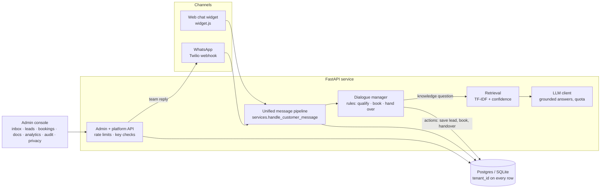
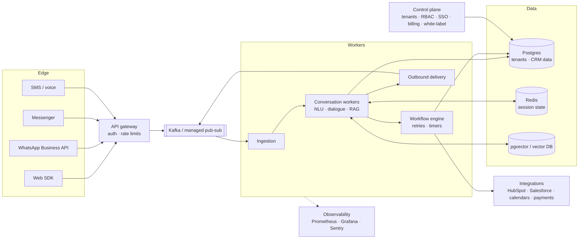

# Architecture

## PoC (built)

**Request path.** A message arrives from a channel adapter → the tenant is resolved from the key
(or the WhatsApp webhook path) → the message is stored → the dialogue manager decides the next
step → for knowledge questions, retrieval scores the tenant's passages and the LLM (if configured)
phrases an answer from the top passages only → actions (save lead, book, hand over) are applied
in one transaction → replies are stored and returned.

**Why rules plus LLM.** Qualification, booking and handover must be predictable and testable,
so they're a state machine (`app/core/dialogue.py`, covered by unit tests). The LLM is used only
where language matters (answering from documents), with a strict prompt, a `NO_ANSWER` escape,
and a per-tenant token quota.

**Confidence and handover.** Retrieval reports how much of the question (IDF-weighted) the best
passage covers. Below the tenant's threshold the agent says it isn't sure; after two misses it
hands the chat to a person with the full history. Customers can also ask for a person at any time.

## Target architecture (roadmap)

The PoC's seams map directly onto this: channel adapters already normalise to one message
format (→ Kafka topics), `app/core` has no web or database code (→ conversation workers), and
`retrieve()` has a stable interface (→ pgvector/hybrid search).

## RFP requirements: status

| RFP requirement | PoC | Where / next step |
|---|---|---|
| Multi-tenant control plane | ✅ tenants, onboarding API and console, isolation, hashed keys, key reset, per-tenant config | RBAC, SSO, billing: phase 3 |
| Channel adapters | ✅ web SDK, WhatsApp (Twilio) in and out | Messenger, SMS, WhatsApp Business API direct |
| Message bus / event stream | ◐ unified pipeline + event table | Kafka between adapters and workers |
| NLU + dialogue manager + response generator | ✅ rule-based state machine, LLM for answers | ML intent model when data exists |
| Knowledge layer (RAG) | ✅ chunking, retrieval with confidence, sources | pgvector embeddings, hybrid search |
| Workflow engine | ◐ booking, lead save, handover actions | general workflows with retries and timers |
| Integrations (CRM, calendar, payments) | ◐ built-in booking calendar | HubSpot/Salesforce, Google Calendar, payment links |
| Human-agent UI | ✅ inbox, transcript, lead context, reply, hand back, cancel bookings | suggested replies, assignment, SLAs |
| Observability and analytics | ✅ dashboard: conversations, leads, bookings, escalations, intents | Prometheus/Grafana, tracing |
| Security and data controls | ✅ isolation, hashed keys, rate limits, key-guessing lockout, widget website allowlist, PII redaction in logs, masked numbers, signature checks, quotas, audit log, customer data erasure, retention purge | encryption keys per tenant, scheduled retention, consent capture, shared rate limits (Redis) |

✅ built · ◐ partly built
