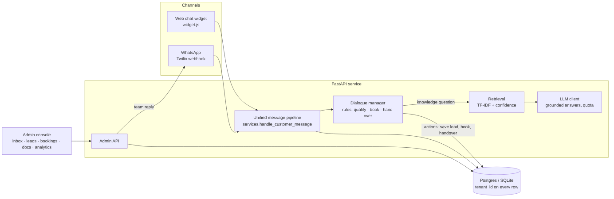
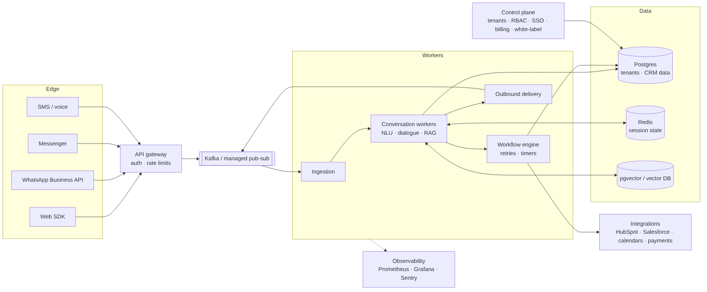

# AgentGrid: technical proposal and PoC

**RFP:** TTG-AI-AGENTGRID · **Submitted by:** Alok Kumar, bigO · **Date:** 2 November 2026
**Live demo:** [link] · **Repository:** [link] · **Video (3 min):** [link]

---

## 1. Summary

We built a working proof of concept of AgentGrid: one platform where many businesses each run
their own AI agent. The agent answers customers from the business's own documents (with
sources), qualifies leads, books appointments into real free slots and hands the conversation to
a person when it isn't confident or the customer asks. It works on web chat and WhatsApp through
one message pipeline, and each business gets an admin console with a handover inbox, leads,
bookings, a knowledge base and analytics.

Two demo businesses (a dental clinic and a real-estate agency) run on the same deployment with
fully separate data, so the multi-tenant model can be tested directly.

## 2. The problem we're solving

Businesses lose leads to slow replies, and their teams spend hours answering the same questions.
Building a reliable conversational agent is hard: pure LLM chatbots can invent answers, and
rule-only bots can't handle free text. Agencies want to resell automation but have no
multi-client platform.

## 3. Approach

**Deterministic logic for the steps that must be right, LLM only where language matters.**

- A rule-based dialogue manager runs qualification, booking, cancellation and handover. It is
  a pure, unit-tested state machine with no network or database code.
- Knowledge questions go to retrieval over the tenant's documents. The LLM phrases an answer only
  from the retrieved passages, with an explicit "no answer" escape. Without an LLM key, the agent
  extracts the answer from the documents, so it never depends on one provider.
- Every answer carries its source. Retrieval also returns a confidence score; below the
  threshold the agent says it isn't sure, and on a second miss it hands over to a person.

## 4. What the PoC demonstrates

| Capability | How to see it in the demo |
|---|---|
| RAG answers with sources | Ask the clinic "How much is teeth whitening?" |
| Lead qualification, configurable per business | Say "book an appointment"; clinic and real estate ask different questions |
| Booking into free slots, no double booking | Answer "next week" and the agent offers Monday's slots |
| Side questions mid-flow | While booking, ask "what are your timings?"; it answers and returns to the question |
| Human handover with history | Type "talk to a human", then reply from the admin inbox |
| Low-confidence handover | Ask two unrelated questions |
| WhatsApp | Same pipeline via the Twilio webhook; team replies are sent back on WhatsApp |
| Knowledge base management | Admin → Knowledge base: add text or upload a PDF, then ask about it |
| Multi-tenant isolation | Clinic keys can't read or post to real-estate data (covered by tests) |
| Analytics | Admin → Overview: conversations, lead and booking rates, escalation rate, intents |
| Onboarding a new business | `/platform`: name, template, hours and first knowledge; it gets its own keys and can chat at once |
| Booking changes | Admin → Bookings → Cancel: the slot frees up and the customer is told in their chat |
| Privacy and audit | Admin → Privacy: erase a customer by phone or email, delete old chats; Admin → Audit log |
| Abuse protection | Rate limits, key-guessing lockout, widget restricted to the business's own websites |

## 5. Architecture

**PoC stack:** Python, FastAPI, SQLAlchemy, Postgres (SQLite locally), Docker, any
OpenAI-compatible LLM, Twilio for WhatsApp, a dependency-free JavaScript widget.

**Target stack:** API gateway, Kafka or managed pub-sub between channel adapters and
conversation workers, Redis for session state, Postgres with pgvector (or a managed vector DB),
a workflow engine for multi-step actions, Kubernetes, Prometheus/Grafana and Sentry.

The PoC is built along the same seams as the target: adapters normalise messages to one format,
agent logic is separate from web and data code, and retrieval sits behind a stable interface.

## 6. Multi-tenancy and security

- Every business row carries `tenant_id`; every query filters by the tenant resolved from the key.
- Public widget keys are separate from secret admin keys; admin keys are stored only as SHA-256 hashes.
- Emails and phone numbers are redacted from logs and the audit trail. WhatsApp conversations
  are looked up by a hashed number and displayed masked.
- Twilio webhook signatures are verified. Per-tenant LLM token quotas cap cost.
- Rate limits per conversation, per visitor for new chats, per admin and per WhatsApp sender; an IP that keeps
  guessing keys is locked out. A business can restrict its widget key to its own websites.
- A platform key (separate from every business key) creates businesses and resets admin keys.
- Admins can delete a conversation, erase all data linked to a customer's phone or email, and
  delete conversations older than a chosen number of days. Every action lands in an audit log
  that holds no personal details.
- Roadmap: per-tenant encryption keys, RBAC and SSO, consent capture, scheduled retention jobs,
  rate limits shared across instances (Redis), audit export, option for private model endpoints
  (GDPR; HIPAA for healthcare tenants).

## 7. Scalability path

The service is stateless apart from the database, so it scales horizontally today. Next steps,
in order of need: move session state to Redis; put Kafka between ingestion, conversation workers
and outbound delivery; move retrieval to pgvector with hybrid search; add caching for frequent
answers; run on Kubernetes with autoscaling per worker type.

## 8. Roadmap (mapped to the RFP phases)

| Phase | RFP scope | Already in the PoC | Remaining |
|---|---|---|---|
| 1 · MVP | templated agents, web chat, basic WhatsApp, CRM webhooks, agent console, managed LLM, rule-based dialogue | web chat, WhatsApp, agent console, rule-based dialogue, LLM, per-tenant templates, business onboarding | CRM webhooks, template library per industry |
| 2 · Scale and integrations | more channels, vector RAG, workflow engine, RBAC, isolation, metering | tenant isolation, RAG with sources, token metering | Messenger/SMS, pgvector, workflow engine, RBAC |
| 3 · Agency features | white-label, sandboxing, reseller dashboards, SSO, SLAs | — | all |

## 9. KPIs and testing

We'd track the RFP's KPIs from the event log already in place: first response time, automated
resolution rate, lead conversion, escalation rate, booking rate and LLM usage per tenant (most
are already on the dashboard). Tests: unit tests for the dialogue manager, retrieval, slots, PII
and WhatsApp signing; end-to-end API tests for booking, double-booking protection, handover,
tenant isolation, documents, the WhatsApp webhook, rate limits, onboarding, booking cancellation
and data erasure.

Answer quality is measured, not assumed: a set of 46 customer-style questions written for the two
demo businesses (40 answerable, 6 out of scope) runs as a test. Offline, without an LLM, all 40
answerable questions get a correct answer and all 6 out-of-scope questions are refused. This is our
own small test set, not an independent benchmark. Two harder phrasings, where the customer's key
word never appears in the document, are tracked openly as known gaps; the agent says it isn't sure
instead of guessing. Dense embeddings (roadmap) are the planned fix.

## 10. Risks and how the design handles them

| Risk | Control |
|---|---|
| Hallucinated answers | answers only from retrieved passages, sources shown, confidence threshold, handover |
| Wrong action (bad booking) | bookings come from the rule-based flow, not the LLM; unique slot constraint |
| PII leakage | redaction in logs and events, hashed lookups, masked display |
| Cross-tenant data access | tenant resolved from key on every request; isolation tests |
| Abuse and key guessing | rate limits, lockout after repeated wrong keys, widget website allowlist |
| LLM cost or outage | per-tenant quotas, extractive fallback with no LLM |

## 11. About us

**bigO** is a software studio building custom software and AI automation for growing
businesses: [buildwithbigo.com](https://www.buildwithbigo.com/).

**Alok Kumar**, founder. B.Tech in Artificial Intelligence, Newton School of Technology
(Rishihood University). Built Nexora, a live AI opportunity-discovery platform [link], and
DataPilot, a hybrid RAG assistant [link]. Open-source contributor at ForkMesh.

[Add anything else you want them to know: availability, team, rates.]
